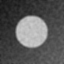

# Лабораторная работа №4

Исследование операций обработки изображений в Engee. Рясной Владимир Олегович, МИК11. Вариант 13: усредняющий фильтр 5×5 при сильном шуме σₙ = 0,10.

Работа выполнена в Engee 18 октября 2026 года. Средний PSNR относительно чистой сцены вырос с **20,1212 до 27,9529 дБ**; ΔPSNR = **+7,8317 дБ**. По заранее заданному порогу +1 дБ операция полезна для данной сцены. Энергия границ и контраст уменьшились: подавление шума сопровождается размытием контура.

## Что открыть

- [Отчёт Word](reports/Рясной_Вариант_13_Лаб04.docx) и [PDF](reports/Рясной_Вариант_13_Лаб04.pdf), 6 страниц.
- [Выполненный ноутбук Engee с пояснениями и выводами](src/LR04_13.ngscript).
- [Архив кода и результатов](artifacts/LR04_13_artifacts.zip).
- [Паспорт](artifacts/passport.md), [полный JSON](artifacts/passport.json).
- [Метрики по seed](artifacts/engee/metrics_by_seed.csv), [полные результаты](artifacts/engee/results.toml).
- [Журнал](experiment_journal.md), [карта требований](docs/REVIEW.md), [проверки](docs/VERIFICATION.md).
- [Методичка](docs/Методические_указания.pdf) и [ответы на вопросы](docs/CONTROL_ANSWERS.md).

## Изображения

Общий диапазон яркости [0, 1], размер каждой сцены 128×128, seed 101. Метрики вычислены по Float64 до кодирования PNG.

| До | Усреднение 5×5 | Чистый эталон |
|---|---|---|
|  |  |  |

| Метрика | До | s базы | После | Δ | Отношение abs(Δ)/s |
|---|---:|---:|---:|---:|---:|
| PSNR, дБ | 20,121169 | 0,061756 | 27,952851 | +7,831682 | 126,82 |
| Энергия границ | 0,058675 | 0,000541 | 0,015911 | −0,042764 | 79,08 |
| Контраст | 0,228521 | 0,000874 | 0,200971 | −0,027550 | 31,53 |

Учебное правило |Δ| > 2s выполняется для трёх метрик; оно не является формальным статистическим тестом и не определяет пользу. Практический допуск ±1 дБ зарегистрирован до запуска. Демо со слабым шумом воспроизведено точно (ΔPSNR = −4,7863 дБ), соседняя сцена с шумом 0,05 дала +2,8656 дБ. Для основной сцены классификация сохраняется при порогах 0,5, 1 и 2 дБ.

## Повторение в Engee

Использованы Engee 26.9.2-H4, кабинет 26.10.1, Julia 1.12.4 и Images 0.26.2. Random, Statistics, SHA, Dates, TOML, Base64, Printf и InteractiveUtils входят в стандартную библиотеку Julia. Учебные библиотеки сохранены без изменений в [src/original](src/original/); происхождение и хеши — в [provenance.json](artifacts/provenance.json).

Загрузите структуру `src/` в новую рабочую папку Engee. Из этой папки выполните:

```julia
include("src/LR04_13.jl")
r = run_lr04("artifacts/run_01"; engee_version="26.9.2-H4", cabinet_version="26.10.1")
```

Версии в аргументах заменяют на фактические, если среда изменилась. Каталог результатов должен быть новым и пустым; при следующем повторе укажите другое имя. Командная строка из папки `lab_04`:

```sh
julia src/LR04_13.jl artifacts/run_01
```

[Сохранённый ноутбук](src/LR04_13.ngscript) содержит выводы первоначального опыта. Перед его повторным выполнением из существующего комплекта замените аргумент `"artifacts"` в ячейке `run_lr04` на новый каталог, например `"artifacts/run_02"`. Первоначальные результаты не перезаписываются. Отображаемая в metadata ноутбука версия ядра может быть шаблонной; фактическая Julia подтверждена выполненной ячейкой и журналом.

## Проверка выгрузки

Для независимой проверки требуются Python 3.11+, NumPy и Pillow; зависимости перечислены в [requirements.txt](requirements.txt).

```sh
python3 -m pip install -r requirements.txt
python3 tools/verify_results.py artifacts/engee
```

Проверяются точный эталон, SHA-256 массивов, фильтр с продолжением краёв replicate, MSE/PSNR, контраст, сводка этих метрик, PNG и классификация. Генератор случайных чисел Julia и оператор Собеля этот независимый проверяющий скрипт не воспроизводит. Отдельный [реальный повтор в Engee](artifacts/engee/recheck.toml) подтвердил точное совпадение всех трёх метрик, эталона, хешей десяти массивов и исходников.

Скрипт сохраняет точные матрицы Float64 little-endian в порядке column-major, три PNG, CSV, TOML и журналы. Для переноса создаётся TOML с Base64 и SHA-256 всех файлов. Его извлекают в новый пустой каталог:

```sh
python3 tools/unpack_export.py /path/to/artifacts_export.toml /path/to/new_output
```

Ограничения: одна синтетическая геометрия, пять реализаций шума, условный практический допуск; PSNR не равен воспринимаемому качеству. Вывод не переносится автоматически на другие сцены и масштабы фильтра.
