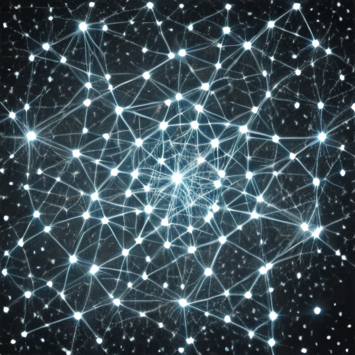

# ЛР05. Запуск открытой модели text-to-image

Рясной Владимир Олегович, МИК11. Вариант 13: постер научной выставки, повтор в одном сеансе. Google Colab, Tesla T4; seed 1013; SD Turbo с закреплённой ревизией.

[Отчёт Word](reports/Рясной_Вариант_13_Лаб05.docx) · [Отчёт PDF](reports/Рясной_Вариант_13_Лаб05.pdf) · [Выполненный блокнот](src/lab05.ipynb) · [Паспорт](artifacts/passport.json)

A и B со свежими CPU-генераторами совпали побитово: max |Δ| = 0, MSE = 0, PSNR = +∞. Для общего генератора PSNR = 11,564944 дБ, max |Δ| = 246; исправленный повтор снова совпал с A. Проверен один сеанс, один бриф и один seed; переносимость на другую машину не заявляется.



Узлы и линии различимы на тёмном фоне. Это художественная сеть без реальных научных данных.

## Файлы

- [Методические указания](docs/Методические_указания.pdf), [варианты](docs/variants_lr05.json), [карта требований](docs/REVIEW.md).
- [Первичные результаты](artifacts/): PNG и manifest.json для A, B, error_first, error_second и corrected; гипотеза до запуска, среда, метрики, run.log, архив экспорта.
- [Журнал](experiment_journal.md), [контрольные ответы](docs/CONTROL_ANSWERS.md), [проверки](docs/VERIFICATION.md), [происхождение](artifacts/provenance.json).
- [Исходная библиотека](src/original/lab05_lib.py) и [демо](src/original/lab05_demo.py) сохранены без изменений. Демо не является результатом варианта 13.

## Повтор в Colab

Откройте [скачанную копию блокнота](src/lab05.ipynb) в новом Colab-блокноте, выберите Python 3 / T4 и выполните ячейки сверху вниз. Вторая кодовая ячейка записывает исходную библиотеку; основная ячейка сохраняет гипотезу до загрузки модели. Последняя ячейка скачивает архив результатов. Результаты нового запуска сохраняйте отдельно от опубликованных первичных данных.

[Исходный онлайн-блокнот](https://colab.research.google.com/drive/1-aojiHYXbNTg3fH-vx1mzm1AaczZ0WSG) — доступ управляется владельцем; копия с выводами в репозитории доступна без Google-аккаунта.

Фактические версии: Python 3.13.15, torch 2.11.0+cu130, CUDA 13.0, diffusers 0.40.0, transformers 5.18.0, Pillow 11.3.0. Дополнительные версии — в [environment.json](artifacts/environment.json). [requirements-colab.txt](requirements-colab.txt) фиксирует версии Python-пакетов; CUDA-сборка PyTorch определяется образом Colab. Обновление среды может изменить выходные хеши.

Для запуска скрипта в совместимой CUDA-среде из папки `lab_05`:

```bash
PYTHONPATH=src/original python src/run_lab05.py
```

Он создаёт `artifacts/` в текущей папке. Для нового опыта запускайте копию в отдельном каталоге, чтобы сохранить исходный экспорт.

## Независимая проверка без GPU

Из папки `lab_05`:

```bash
python -m pip install -r requirements-verify.txt
python -B tools/verify_submission.py
```

Проверяются SHA-256, размеры и параметры PNG, независимые MSE/PSNR/max |Δ|, время записи гипотезы, outputs блокнота, неизменность библиотеки, архив и паспорт, манифест всего комплекта, отсутствие комментариев и исправлений Word. Проверка не запускает модель повторно.

## Модель и лицензия

Модель: `stabilityai/sd-turbo`, ревизия `b261bac6fd2cf515557d5d0707481eafa0485ec2`. Учебное некоммерческое использование. [Лицензия на закреплённой ревизии](https://huggingface.co/stabilityai/sd-turbo/blob/b261bac6fd2cf515557d5d0707481eafa0485ec2/LICENSE.md), [локальная копия](docs/LICENSE_model.md), [карточка модели](docs/MODEL_CARD.md). Веса не включены в комплект. Powered by Stability AI.
