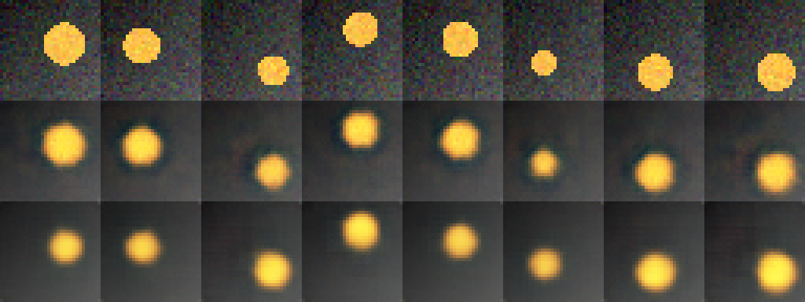

# ЛР07. Построение автокодировщика

Рясной Владимир Олегович, МИК11. Вариант 13: `disc_noise`, латентный вектор **8 → 2**. Эксперимент выполнен 18 октября 2026 года в отдельном Google Colab-сеансе на Tesla T4; пять пар seed 101–105.

[Отчёт Word](reports/Рясной_Вариант_13_Лаб07.docx) · [Отчёт PDF](reports/Рясной_Вариант_13_Лаб07.pdf) · [Выполненный блокнот](src/lab07.ipynb) · [Паспорт](artifacts/passport.json)

Тестовый PSNR снизился с **23,0824 до 21,4431 дБ** (−1,6393 дБ); эталон «средняя картинка» — 16,7632 дБ. Параметров меньше на 12,17%; время изменилось в пределах допуска. Рост разрыва train − test на 0,05702 дБ заметен по учебному критерию 2s, но практически нейтрален при допуске ±0,1 дБ. Критерий 2s не является формальным статистическим тестом.



Строки сверху вниз: восемь шумных оригиналов, A, B. Обе модели сглаживают шум датчика; B хуже передаёт размер дисков. Тестовые эталоны также содержат шум σ=0,05, поэтому PSNR не измеряет только качество чистой геометрии.

## Состав

- [Методичка](docs/Методические_указания.pdf), [карта требований](docs/REVIEW.md), [ответы на 10 вопросов](docs/CONTROL_ANSWERS.md).
- [План до запуска](artifacts/expectations_before_run.json), [первичные значения](artifacts/raw_metrics.json), [агрегаты](artifacts/summary.json), [диагностика d](artifacts/diagnostic.json).
- [Исходные измерения NPZ](artifacts/measurements.npz): поизображенные train/test MSE десяти моделей, восемь float32-входов и реконструкций, чистые сцены и факторы, ошибки эталона.
- [Среда](artifacts/environment.json), [журнал вывода](artifacts/run.log), [журнал эксперимента](experiment_journal.md), [повтор seed 101](artifacts/repeat_check.json), [проверка шума](artifacts/noise_check.json).
- Веса A/B для seed 101 — `artifacts/model_A_seed101.pt` и `model_B_seed101.pt`; словари весов без кода модели.
- [Исходный ZIP-экспорт](artifacts/lab07_13_artifacts.zip), [неизменённая учебная библиотека](src/original/lab07_lib.py), [программа варианта](src/run_lab07.py).
- [Фактические проверки](docs/VERIFICATION.md), [независимый пересчёт](artifacts/independent_verification.json), [манифест](MANIFEST.sha256).

## Запуск в Colab

Загрузите [lab07.ipynb](src/lab07.ipynb) в **новый** сеанс Colab Python 3 / T4 и выполните четыре ячейки сверху вниз. Первые две записывают исходные файлы. Третья фиксирует план до обучения, выполняет демонстрацию N=1 целиком, затем отдельную серию N=13, диагностику и повтор. Четвёртая выводит журнал и скачивает архив. Для повторения нужен новый рабочий каталог: программа намеренно останавливается, если `artifacts/` уже существует.

[Онлайн-блокнот](https://colab.research.google.com/drive/1X40GiBPImwuvVHa6RPSJ6Fkju7uUo2M9) — доступ управляется владельцем; копия с outputs включена в репозиторий.

Среда опыта: Python 3.13.15, torch 2.11.0+cu130, CUDA 13.0, numpy 2.1.3, Pillow 11.3.0. [Зависимости](requirements-colab.txt); полный список пакетов и nvidia-smi — в паспорте среды. Детерминированность CUDA принудительно не включалась: последние знаки PSNR и время могут отличаться.

Для отдельного повторения из папки `lab_07` в совместимой CUDA-среде:

```bash
mkdir repeat_run
cp src/original/lab07_lib.py src/original/lab07_demo.py src/run_lab07.py repeat_run/
cd repeat_run
python run_lab07.py
```

Каталог повторного опыта не включайте в исходный комплект. Данные генерируются кодом, внешние веса не скачиваются. Диагностика d=2/8 использует seed 101–103 основной серии, d=1/3/4 обучены отдельно. Демонстрационный N=1 относится к другому, чистому набору.

## Проверка без GPU

Из папки `lab_07`:

```bash
python -m pip install -r requirements-verify.txt
python -B tools/verify_submission.py
```

Проверка независимо создаёт все 5120 синтетических сцен и эталон, сверяет восемь входов по пикселям, пересчитывает PSNR из сохранённых MSE, агрегаты, лист сравнения, структуру блокнота, отчёты и SHA-256 всех файлов. GPU-обучение не повторяется. Отдельный повтор seed 101 уже выполнен в исходном Colab-сеансе; новая серия на другой машине не заявляется.

## Происхождение

Методичка и библиотека предоставлены как учебные материалы; отдельная лицензия в приложенном комплекте не указана. Внешние изображения, персональные данные и предобученные модели не используются. `lab07_lib(1).py` сохранён как второй приложенный файл и побайтово совпадает с основной библиотекой. Исходные демонстрационные результаты преподавателя не использованы вместо собственных измерений.
