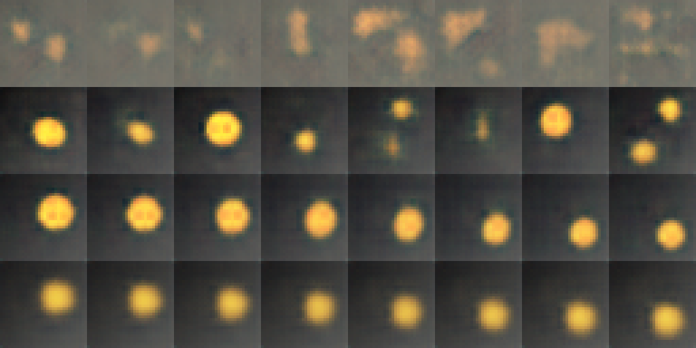

# ЛР08. Генерация и интерполяция в латентном пространстве

Рясной Владимир Олегович, МИК11. Вариант 13: `disc_noise`, вес KL-члена **β = 1 → 8**. Работа выполнена 29 октября 2026 года в Engee 26.10.2-H2 на CPU; пять пар seed 101–105.

[Отчёт Word](reports/Рясной_Вариант_13_Лаб08.docx) · [Отчёт PDF](reports/Рясной_Вариант_13_Лаб08.pdf) · [Паспорт](artifacts/passport.json) · [Проверки](docs/VERIFICATION.md)

| Показатель | A | B | Δ | Выше 2s | По допуску |
|---|---:|---:|---:|---|---|
| Реконструкция, дБ | 23,1183 | 20,9105 | −2,2077 | да | ухудшение |
| Интерполяция, дБ | 22,5746 | 21,9382 | −0,6364 | нет | нейтрально |
| Сэмплы, дБ | 21,3179 | 21,5538 | +0,2358 | нет | нейтрально |
| R² факторов | 0,90764 | 0,86679 | −0,04085 | да | нейтрально |

Допуски заранее: ±1 дБ и ±0,05 R². **R² показывает расхождение критериев:** снижение выше удвоенного разброса A, но внутри практического допуска. Критерий 2s — учебная мера эффекта относительно разброса seed, не формальный статистический тест.



Строки сверху вниз: сэмплы обычного AE, сэмплы VAE A, линейный путь A и путь B. Seed обучения 101, сэмплов 5; путь между тестовыми сценами 0 и 2. У VAE меньше зернистости; при β=8 границы размываются и различия радиусов сглаживаются. Некоторые сэмплы имеют овальную форму — идеальные диски не гарантированы.

## Материалы

- [Методичка](docs/Методические_указания.pdf), [карта требований](docs/REVIEW.md), [ответы на 10 вопросов](docs/CONTROL_ANSWERS.md).
- [Гипотеза до обучения](artifacts/expectations_before_run.json), [десять первичных записей](artifacts/raw_metrics.json), [сводка](artifacts/summary.json), [классификация](artifacts/classification.json).
- `artifacts/measurements_A_101.npz` … `measurements_B_105.npz`: ошибки 1024 реконструкций, 3×200 интерполяций, 256 сэмплов, ближайшие соседи, μ обучающей/тестовой выборок, log σ², факторы и визуальные результаты. Отдельно — `measurements_AE_101.npz` и `dataset_evidence.npz`.
- [Диагностика всех seed](artifacts/diagnostic.json), [обычный AE](artifacts/ae_diagnostic.json), [проверка шума](artifacts/independent_verification.json), [шум и форма дисков](artifacts/noise_comparison.png).
- [Демонстрация N=1](artifacts/demo_summary.json), [сопоставление с методичкой](artifacts/demo_comparison.json), [лист демонстрации](artifacts/comparison_demo01.png).
- [Дополнительная проверка интерполяции](artifacts/interpolation_control.json), [линейный и сферический пути](artifacts/interpolation_methods.png). Она выполнена на одной модели и не входит в серию фактора β.
- [Среда Python](artifacts/environment.json), [Julia и хеши в Engee](artifacts/engee/environment.log), [время 34 обучений](artifacts/training_times.json), [полный журнал](artifacts/run.log), [снимок консоли](artifacts/engee/console_summary.png).
- [Повтор A/B seed 101](artifacts/repeat_check.json): все четыре показателя совпали с первоначальными. Полный повтор всех моделей на другой машине не заявляется.
- Веса трёх моделей seed 101: `model_A_seed101.pt`, `model_B_seed101.pt`, `model_AE_seed101.pt` в `artifacts/`; словари тензоров без кода модели.
- [Исходный экспорт Engee ZIP](artifacts/lab08_13_artifacts.zip), [журнал опыта](experiment_journal.md), [манифест SHA-256](MANIFEST.sha256).

## Проверка без обучения

Из папки `lab_08`:

```bash
python -m pip install -r requirements-verify.txt
python -B tools/verify_submission.py
python src/print_results.py
```

Проверка заново создаёт 5120 сцен, сверяет восемь входов по пикселям, пересчитывает четыре показателя, sA и 2s, поосевой KL, лист сравнения, исходный ZIP, структуру DOCX и все SHA-256. PyTorch и Engee для неё не требуются. Расхождение PSNR при независимом пересчёте не превысило 0,000003 дБ.

## Повторное обучение

Исходная среда: Python 3.11.11, PyTorch 2.4.1+cpu, NumPy 2.1.3, Pillow 11.1.0, Julia 1.12.6. В Engee PyTorch первоначально отсутствовал; установлен из официального CPU-репозитория. Данные генерируются программой; внешние веса не скачиваются.

В совместимой Python-среде:

```bash
python -m pip install torch==2.4.1 --index-url https://download.pytorch.org/whl/cpu
python -m pip install -r requirements-engee.txt
mkdir repeat_run
cp src/original/lab07_lib.py src/original/lab08_lib.py repeat_run/
cp src/original/lab08_demo.py src/run_lab08.py repeat_run/
cd repeat_run
python run_lab08.py
```

Программа намеренно останавливается, если `artifacts/` уже существует. Повтор занимает около 20–25 минут на сопоставимом CPU. Выполняются исходная демонстрация целиком, основной вариант, AE-диагностика, дополнительный контроль интерполяции и повтор seed 101. Итог — `artifacts/` и `lab08_13_artifacts.zip`. Повторный каталог не включайте в сдаваемый комплект.

Для запуска именно в Engee создайте **новую** папку ЛР08 и загрузите в неё четыре Python-файла из команды выше и [start_engee.jl](src/start_engee.jl). В командной строке Julia перейдите в созданную папку и выполните `include("start_engee.jl")`. Он проверяет версии и SHA-256, затем запускает программу с выводом в `process.log`. Консоль может оставаться занятой; текущие результаты доступны в панели файлов. После завершения скачайте ZIP. Файлы прежних лабораторных не изменяются.

## Метод и ограничения

Adam, lr=0,002, batch=128, 30 эпох, 960 обновлений; разогрев KL за 10 эпох, d=8, τ=1. Seed данных 7, пар 11; 200 пар в t=0,25/0,5/0,75, 256 сэмплов с seed=1000+seed обучения. Активность оси: средний тестовый KL>0,05 нат.

Реконструкция и сэмплы оцениваются относительно **шумных** тестовых изображений. Эталон интерполяции — **чистый** рендер промежуточных факторов. PSNR ближайшего соседа не оценивает разнообразие, R² не доказывает независимость осей. Пять seed характеризуют обучение на одной фиксированной синтетической выборке; результат не переносится на фотографии без проверки.

Учебные библиотеки сохранены без изменений, происхождение и байты — в [source_provenance.json](docs/source_provenance.json). `lab07_lib.py` взят из исходного комплекта ЛР07; два приложенных экземпляра `lab08_lib.py` побайтово совпадают. Отдельная лицензия в предоставленном комплекте не указана. Числа преподавательских журналов не подменяют собственные измерения.
