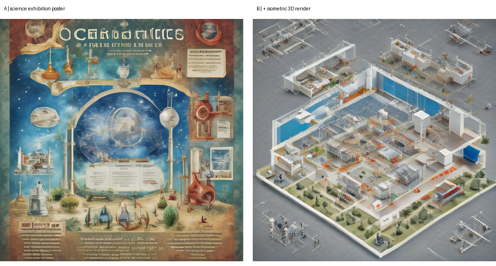

# Лабораторная работа №9 — Промпт-инжиниринг

Рясной Владимир Олегович, МИК11, вариант 13. Контекст — плакат научной выставки; фактор — `isometric 3D render`. Эксперименты выполнены 1 ноября 2026 года.

[Отчёт Word](reports/Рясной_Вариант_13_Лаб09.docx) · [Отчёт PDF](reports/Рясной_Вариант_13_Лаб09.pdf) · [Архив артефактов](artifacts/experiment_artifacts.zip) · [Проверки](docs/VERIFICATION.md)

Стилевая фраза повысила CLIP-сходство с изометрией на **15,72 пункта**, но снизила сходство с исходным научным плакатом на **8,27 пункта**. На seed 101 плакат сменился макетом выставочного пространства. Гипотеза роста целевой метрики подтверждена, гипотеза сохранения предмета — нет. Это синтетические образы, а не визуализация научных данных.



| Метрика | Среднее A | s A | Среднее B | Δ | \|Δ\|/s | Порог 2s |
|---|---:|---:|---:|---:|---:|---|
| clip_target | 8,8382 | 0,9964 | 24,5586 | +15,7204 | 15,777 | да |
| clip_subject | 23,7508 | 0,5191 | 15,4772 | −8,2736 | 15,939 | да |
| edge | 0,036151 | 0,001792 | 0,029269 | −0,006882 | 3,840 | да |
| contrast | 0,143760 | 0,013672 | 0,126465 | −0,017296 | 1,265 | нет |

Все изменения превысили заранее заданный практический допуск. Рост целевой метрики сопровождается ухудшением сохранности предмета. Правило 2s — учебный порог относительно разброса, без формального статистического теста.

| Приём | K1 | K2 | K3 | K4 |
|---|---:|---:|---:|---:|
| zero-shot | 1,000 | 1,000 | 1,000 | 0,867 |
| few-shot | 1,000 | 1,000 | 1,000 | 0,933 |
| пошаговый | 1,000 | 1,000 | 1,000 | 0,867 |

По три повтора в новом чате, пять описаний на ответ. ChatGPT web, High (3 из 3); точное имя модели интерфейс не раскрывает. K4 рассчитан по 30 зависимым сравнениям на приём. Разница в два совпадения не доказывает универсального преимущества few-shot.

## Проверка скачанного комплекта

Из папки `lab_09`, Python 3.11 или новее:

```sh
python -m pip install -r requirements-verify.txt
python tools/verify_results.py
python src/score_answers.py
```

Проверяются первичные PNG, хеши, повтор A/B, метрики, все девять ответов, точные тексты запросов и байты учебных файлов. CLIP повторно не загружается: проверяется арифметика сохранённых CLIP-измерений; edge и contrast пересчитываются по PNG.

## Новый эксперимент в Engee

Использован Python 3.11.11, PyTorch 2.4.1+cpu, diffusers 0.32.2, transformers 4.57.6; CPU float32, 4 потока. Веса SD Turbo и CLIP загружаются по ревизиям из паспорта. Установка пакетов выполняется в выбранном окружении; существующий PyTorch не обновлять.

```sh
python -m pip install -r requirements-engee.txt
python src/run_variant13.py --output artifacts/new_run
```

Повтор создаёт новую папку. Первоначальную `artifacts/part1` не заменять. `src/repeat_seed101.py` — отдельная дополнительная проверка A/B; её папка уже содержит выполненный повтор, поэтому для нового повтора нужна чистая копия проекта без этой папки или другое имя выходной папки в скрипте.

Для новой серии языковой модели выведите запрос и отправьте его в новый чат три раза на приём; сохраните полный ответ без правок:

```sh
python src/original/lab09_llm.py prompt zero 3
python src/original/lab09_llm.py prompt few 3
python src/original/lab09_llm.py prompt step 3
python src/score_answers.py --answers path/to/new_answers
```

## Материалы

- [Методичка](docs/ЛР09_Промпт-инжиниринг_МУ.pdf), [карта требований](docs/REVIEW.md), [гипотезы до опыта](docs/HYPOTHESES.md), [источники и лицензии](docs/SOURCES.md).
- [Первичные результаты](artifacts/part1/results.json), [паспорт Engee](artifacts/part1/passport.json), [журнал запуска](artifacts/engee/run.log).
- [Девять полных ответов](artifacts/answers/), [запросы](artifacts/prompts/), [оценки K1–K4](artifacts/llm_results.json), [паспорт языковой модели](artifacts/llm_passport.json).
- [Отдельный повтор](artifacts/repeat_seed101/result.json), [журнал](experiment_journal.md), [происхождение исходников](docs/SOURCE_PROVENANCE.json), [SHA-256](MANIFEST.sha256).

Учебные файлы в `src/original/` не изменены. Добавлены отдельные скрипты запуска варианта, повтора и оценки. Веса моделей в репозиторий не включены. Powered by Stability AI.
