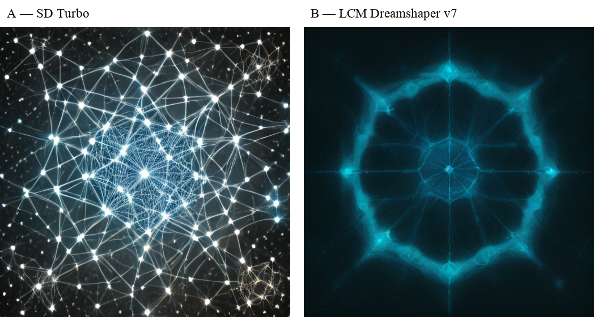

# Лабораторная работа №10 — Сравнительное исследование моделей text-to-image

Рясной Владимир Олегович, МИК11, вариант 13. Бриф 3 — плакат научной выставки. A — SD Turbo (1 шаг, guidance 0), B — LCM Dreamshaper v7 (4 шага, guidance 8). CPU float32, четыре потока, seed 101–105.

[Отчёт Word](reports/Рясной_Вариант_13_Лаб10.docx) · [Отчёт PDF](reports/Рясной_Вариант_13_Лаб10.pdf)

Отчёт содержит 28 страниц: основную часть и отдельные листы приложений со всеми первичными измерениями, пятью анонимными парами, причинами выбора, раскрытым ключом, гипотезами до опыта, паспортом, журналом, алгоритмами и 12 ответами. Для содержательной проверки достаточно одного отчёта.

Среднее clip_brief у LCM выше на 1,985 пункта; практический порог 1 пункт превышен, учебный порог 2s не пройден. LCM генерировала в среднем в 2,129 раза медленнее. В слепом сравнении SD Turbo выбрана 4 раза, LCM — 1 раз. Это результат одного брифа и одного наблюдателя, не универсальный рейтинг моделей.



- [Методичка](docs/Методические_указания.pdf)
- [Карта выполненных требований](docs/REVIEW.md)
- [Гипотезы до запуска](docs/hypotheses_before_run.json)
- [Числовые результаты](docs/NUMERICAL_RESULTS.md)
- [Первичные измерения CSV](artifacts/measurements.csv)
- [Протокол слепой оценки](artifacts/visual_assessment.json)
- [Первичный экспорт Engee](artifacts/engee_results.zip)
- [Проверка](docs/VERIFICATION.md) и [журнал](experiment_journal.md)
- [Ответы на 12 вопросов](docs/CONTROL_ANSWERS.md)
- [Происхождение библиотеки](docs/SOURCE_PROVENANCE.json) и [источники и лицензии](docs/SOURCES.md)
- [Контрольные суммы файлов](MANIFEST.sha256)

## Проверка сохранённых результатов

Из папки `lab_10`, Python 3.11 и NumPy/Pillow из списка зависимостей:

```sh
python tools/verify_results.py --require-blind
python src/summarize_results.py
shasum -a 256 -c MANIFEST.sha256
```

Проверка пересчитывает арифметику CLIP по сохранённым сходствам и пиксельные метрики по десяти PNG, проверяет конфигурации, хеши исходников, два совпавших повтора seed 101 и протокол слепой оценки. Эмбеддинги CLIP заново не вычисляются.

## Новый запуск в Engee

Новый опыт выполняйте в отдельной рабочей копии `lab_10`: исполнитель сохраняет экспорт под фиксированным именем `artifacts/engee_results.zip`. Исходный опубликованный комплект сохраняйте отдельно. В рабочей копии используйте Python 3.11; установленный PyTorch 2.4.1+cpu не обновлять:

```sh
python -m pip install -r requirements-engee.txt
python src/run_variant13.py --output artifacts/new_run
```

Папка вывода должна быть новой; опубликованный первичный опыт остаётся в `artifacts/main`. Скрипт сохраняет десять PNG, JPEG quality 90 для слепых листов, пять листов, ключ, измерения и паспорт. Отдельно повторяет seed 101 обеих моделей. Ключ читается после фиксации выбора по пяти листам. Загрузка, прогрев, CLIP и запись файлов исключены из seconds. Повтор зависит от платформы и версий; время общего CPU не контролировалось.

Учебная библиотека восстановлена из приложения А к PDF: исправлены только разрывы строк PDF внутри токенов и строковых литералов. Исходное извлечение сохранено рядом с кодом; отдельный архив учебных скриптов не предоставлялся. Веса моделей не распространяются. Powered by Stability AI.
